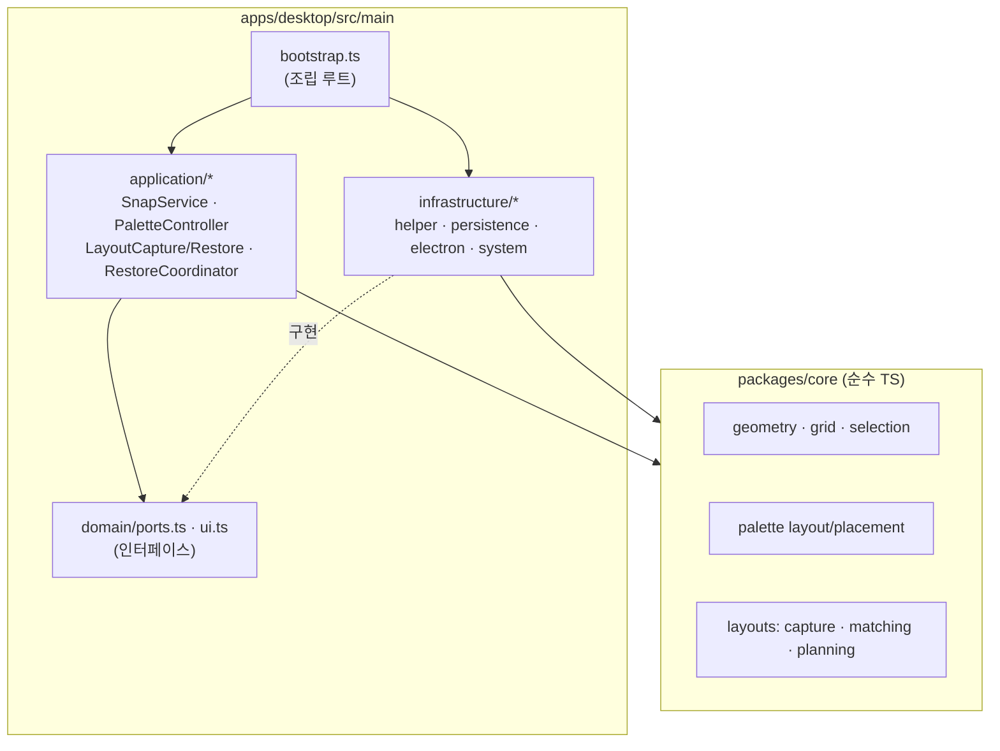
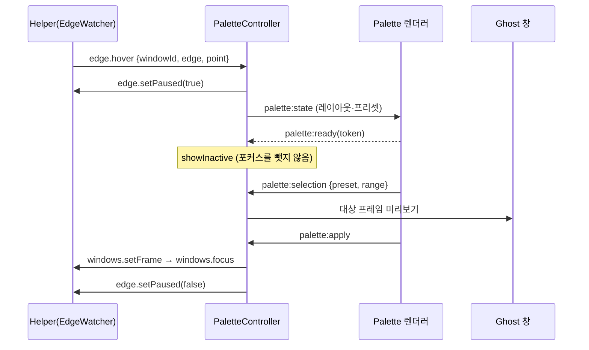
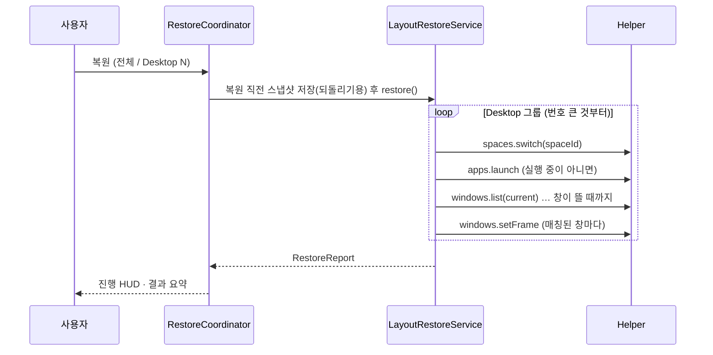

## 프로세스

| 프로세스        | 언어             | 책임                                                                                         |
| --------------- | ---------------- | -------------------------------------------------------------------------------------------- |
| Electron 메인   | TypeScript       | 설정·레이아웃 저장, 기능 흐름 조율(application 서비스), 창·트레이·단축키                     |
| Electron 렌더러 | TypeScript/React | 팔레트, 미리보기(ghost), 관리 창, 저장 HUD, 복원 HUD                                         |
| MagWinHelper    | Swift            | 전역 커서 감시와 가장자리 판정, 창 목록·이동(Accessibility), Desktop 정보(CGS)·전환, 앱 실행 |

렌더러는 `window.magwin`(preload가 노출한 허용 목록 API)으로만 메인과 대화하고, 메인은 헬퍼와 [JSON Lines 프로토콜](helper-protocol.md)로 대화합니다.

## 계층

- **의존성 역전**: application은 `domain/ports.ts`의 작은 인터페이스(`WindowMover`, `DesktopNavigator`, `AppLauncher` …)에만 의존합니다. 헬퍼·파일·Electron 구현은 infrastructure에 있고, `bootstrap.ts`만 구체 클래스를 `new` 합니다. ESLint `no-restricted-imports`가 이 방향을 강제합니다.
- **순수 로직은 core로**: 선택 규칙, 셀 → 좌표, 팔레트 배치, 캡처 필터, 창 매칭, 복원 계획은 입력과 출력만 있는 함수라서 테스트가 쉽습니다.
- 헬퍼도 같은 구조입니다. `HelperCore`(순수: 프로토콜, 가장자리 판정, dwell 상태 머신, 단축키 파서, 전환 계획) / `HelperPlatform`(AX·CG·CGS 어댑터) / `MagWinHelper`(조립과 RPC 등록).

## 기능 1 흐름

## 기능 2 흐름

## 파일로 남는 것

`~/Library/Application Support/magWin/`

| 파일                 | 내용                                         |
| -------------------- | -------------------------------------------- |
| `settings.json`      | 설정 (섹션별로 검증, 잘못된 섹션만 기본값)   |
| `layouts/<id>.json`  | 레이아웃 1개 (zod 스키마 `schemaVersion: 1`) |
| `layouts/order.json` | 목록 순서 = 단축키 슬롯                      |

모든 파일은 임시 파일에 쓴 뒤 이름을 바꾸는 방식으로 원자적으로 저장합니다.
