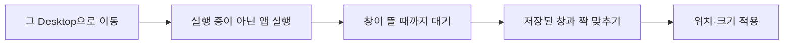

## 저장

메뉴 막대 아이콘의 **현재 레이아웃 저장…** 또는 **⌃⌥⌘S**를 누르면 저장 HUD가 뜹니다.

1. **범위**를 고릅니다. "모든 Desktop"(기본) 또는 "현재 Desktop만"입니다.
2. Desktop별 와이어프레임과 창 목록에서 뺄 창의 체크를 해제합니다. 설정 › 레이아웃의 "저장할 때 기본으로 빼는 앱"에 있는 앱은 처음부터 해제되어 있습니다.
3. 이름을 정하고(기본값은 저장 시각) **저장**을 누릅니다.

창마다 저장되는 정보는 다음과 같습니다.

| 항목        | 예                                           | 쓰임                          |
| ----------- | -------------------------------------------- | ----------------------------- |
| 앱          | 번들 ID, 이름, 설치 경로                     | 실행 중이 아니면 실행         |
| 창 제목     | `main.ts — OrgaWin` (없을 수 있음)           | 같은 앱의 여러 창 짝 맞추기   |
| 위치·크기   | 절대 좌표 + 화면 대비 비율                   | 모니터가 바뀌어도 비율로 복원 |
| 디스플레이  | 디스플레이 UUID                              |                               |
| **Desktop** | Desktop 번호, 디스플레이 내 순서, Space UUID | 복원 전에 이 Desktop으로 이동 |

전체 화면 창과 숨긴(⌘H)·최소화된 창은 저장하지 않습니다.

## 복원

| 방법                                        | 복원 범위                  |
| ------------------------------------------- | -------------------------- |
| 메뉴 막대 › 레이아웃 › **전체 복원**        | 레이아웃 전체              |
| 메뉴 막대 › 레이아웃 › **Desktop N만 복원** | 그 Desktop의 창만          |
| 관리 창 › 레이아웃 카드의 버튼              | 위와 같음                  |
| **⌃⌥⌘1 ~ ⌃⌥⌘9**                             | 목록 1~9번째 레이아웃 전체 |

복원은 Desktop 단위로 진행합니다. Desktop마다 다음 순서를 따릅니다.

- **번호가 큰 Desktop부터** 처리합니다. 그래서 복원이 끝나면 레이아웃에서 가장 앞 Desktop(보통 Desktop 1)에 머뭅니다.
- 진행 상황은 화면 오른쪽 위 HUD에 표시됩니다. 문제없이 끝나면 4초 뒤 스스로 닫힙니다.
- 복원 직전 배치를 자동으로 기억합니다. **직전 배치로 되돌리기**로 돌아갈 수 있습니다(되돌리기는 앱을 새로 실행하지 않습니다).

## 결과 보고의 의미

| 보고                                   | 뜻과 해결                                                                                                                                                      |
| -------------------------------------- | -------------------------------------------------------------------------------------------------------------------------------------------------------------- |
| 창이 Desktop N에 있어요                | 앱이 이미 실행 중이고 창이 다른 Desktop에 있습니다. macOS가 창을 옮기는 API를 주지 않아서, 앱을 종료한 뒤 다시 복원하거나 Mission Control에서 끌어다 놓으세요. |
| Desktop N이 없어서 현재 Desktop에 배치 | Mission Control에서 Desktop을 추가하면 다음 복원부터 제자리로 갑니다.                                                                                          |
| Desktop N으로 전환하지 못했어요        | Mission Control 단축키가 꺼져 있습니다. [시작하기](getting-started.md#desktop-전환-단축키)를 보세요.                                                           |
| 앱이 설치되어 있지 않아요              | 번들 ID로도, 저장된 경로로도 앱을 찾지 못했습니다.                                                                                                             |
| 창을 찾지 못했어요                     | 앱이 창을 열지 않았거나(문서 없이 실행되는 앱 등) 제한 시간(15초) 안에 뜨지 않았습니다.                                                                        |

## 한계

- 앱 내부 상태(브라우저 탭, 열린 문서)는 각 앱의 세션 복원에 맡깁니다. OrgaWin은 **앱과 창의 위치**를 복원합니다.
- 같은 앱의 창이 여러 개면 제목 유사도와 위치로 짝을 맞춥니다. 다른 Desktop 창은 화면 기록 권한이 없으면 제목을 몰라서 순서로 맞춥니다.
- 창의 Desktop 정보는 macOS 비공개 API로 읽습니다. macOS 업데이트 후에는 [수동 점검](../development/testing.md#수동-점검-목록)을 다시 하세요.
