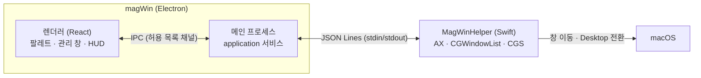

magWin은 macOS 메뉴 막대에 상주하는 창 관리 앱입니다. 두 가지 일을 합니다.

| 기능                 | 한 줄 설명                                                                                                                | 문서                                     |
| -------------------- | ------------------------------------------------------------------------------------------------------------------------- | ---------------------------------------- |
| **엣지 그리드 스냅** | 다른 앱 창의 가장자리에 커서를 잠시 두면 그리드 팔레트가 뜨고, 고른 칸(직사각형)으로 그 창을 옮깁니다.                    | [엣지 스냅 사용법](guide/edge-snap.md)   |
| **Desktop 레이아웃** | 지금 창 배치를 창마다 어느 Desktop에 있었는지까지 저장하고, 복원할 때 그 Desktop으로 먼저 이동한 뒤 앱을 띄워 배치합니다. | [레이아웃 저장과 복원](guide/layouts.md) |

## 구성



- UI와 로직은 **TypeScript**(Electron + React)입니다. 규칙은 [코딩 표준](development/coding-standards.md)을 따릅니다.
- 다른 앱의 창을 읽고 옮기는 일은 Electron이 할 수 없어서 작은 **Swift 헬퍼**가 맡습니다. 이유는 [ADR-001](architecture/decisions/adr-001-swift-helper-process.md)에 있습니다.

## 빠른 시작

```bash
pnpm install
pnpm dev
```

`pnpm dev`는 Swift 헬퍼를 빌드한 뒤 앱을 띄웁니다. 처음 실행하면 **손쉬운 사용** 권한을 요청합니다. 자세한 내용은 [시작하기](guide/getting-started.md)를 보세요.

## 알아둘 제약

- macOS에는 다른 앱의 창을 특정 Desktop으로 보내는 **공개 API가 없습니다.** 그래서 magWin은 "Desktop으로 먼저 이동 → 그곳에서 앱 실행 → 배치" 순서로 복원합니다 ([ADR-002](architecture/decisions/adr-002-desktop-first-restore.md)).
- Desktop 전환은 사용자가 설정한 Mission Control 단축키를 대신 눌러서 합니다 ([ADR-003](architecture/decisions/adr-003-keyboard-desktop-switching.md)).
- 개발 환경: macOS 26.6 (Apple Silicon), Xcode 26 / Swift 6.2, Node 22.
