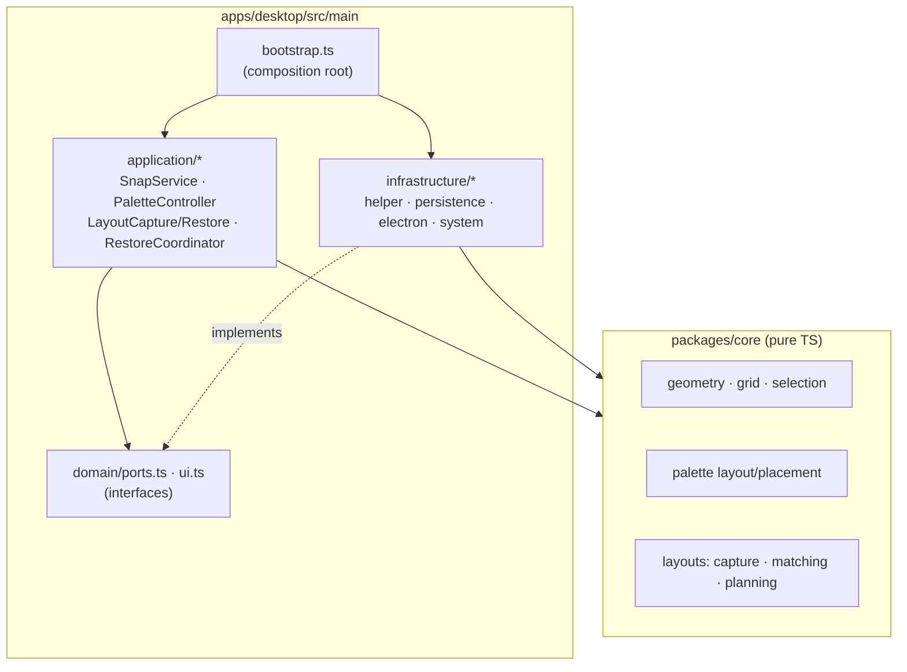
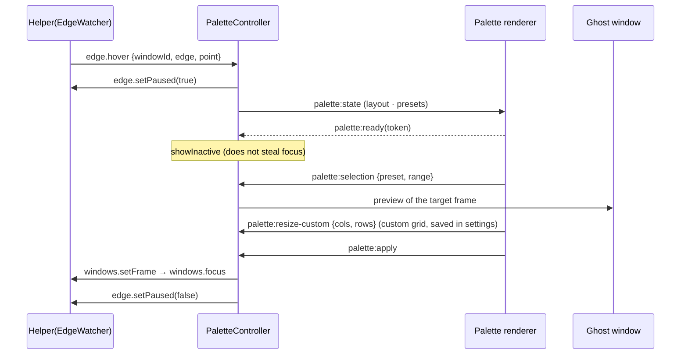
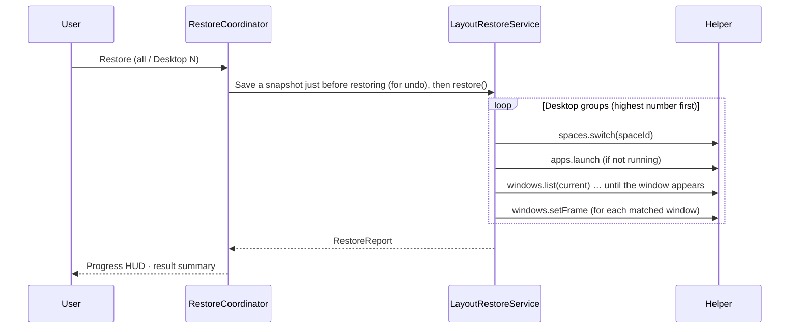

## Processes

| Process           | Language         | Responsibility                                                                                                                        |
| ----------------- | ---------------- | ------------------------------------------------------------------------------------------------------------------------------------- |
| Electron main     | TypeScript       | Persists settings and layouts, orchestrates feature flows (application services), manages windows, tray, and shortcuts                |
| Electron renderer | TypeScript/React | Palette, preview (ghost), management window, save HUD, restore HUD                                                                    |
| MagWinHelper      | Swift            | Global cursor watching and edge detection, window listing and moving (Accessibility), Desktop info (CGS) and switching, app launching |

The renderer talks to main only through `window.magwin` (an allowlisted API exposed by the preload script), and main talks to the helper over the [JSON Lines protocol](helper-protocol.md).

## Layers

- **Dependency inversion**: the application layer depends only on the small interfaces in `domain/ports.ts` (`WindowMover`, `DesktopNavigator`, `AppLauncher`, and so on). The helper, file, and Electron implementations live in infrastructure, and only `bootstrap.ts` calls `new` on concrete classes. The ESLint rule `no-restricted-imports` enforces this direction.
- **Pure logic goes in core**: selection rules, cell-to-coordinate conversion, palette placement, capture filters, window matching, and restore planning are functions with only inputs and outputs, so they are easy to test.
- The helper has the same structure: `HelperCore` (pure: protocol, edge detection, dwell state machine, shortcut parser, switch planning), `HelperPlatform` (AX, CG, and CGS adapters), and `MagWinHelper` (composition and RPC registration).

## Feature 1 flow

## Feature 2 flow

## What is persisted to files

`~/Library/Application Support/OrgaWin/`

| File                 | Contents                                                                   |
| -------------------- | -------------------------------------------------------------------------- |
| `settings.json`      | Settings (validated per section; only invalid sections revert to defaults) |
| `layouts/<id>.json`  | One layout (zod schema `schemaVersion: 1`)                                 |
| `layouts/order.json` | List order = shortcut slots                                                |

Every file is saved atomically by writing to a temporary file and then renaming it.
