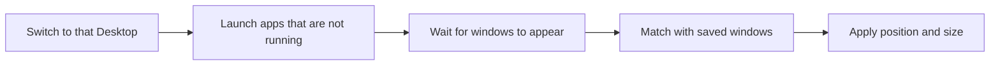

## Save

Choose **Save current layout…** from the menu bar icon, or press **⌃⌥⌘S**, and the save HUD appears.

1. Choose the **scope**: "All Desktops" (default) or "Current Desktop only".
2. In the per-Desktop wireframe and window list, uncheck windows to leave out. Apps listed under Settings › Layouts › "Apps excluded by default when saving" start unchecked.
3. Enter a name (the default is the save time) and click **Save**.

The following is saved for each window.

| Item          | Example                                          | Used for                                     |
| ------------- | ------------------------------------------------ | -------------------------------------------- |
| App           | Bundle ID, name, install path                    | Launch the app if it is not running          |
| Window title  | `main.ts — magWin` (may be missing)              | Match up multiple windows of the same app    |
| Position/size | Absolute coordinates + ratio to the screen       | Restore by ratio even if the monitor changes |
| Display       | Display UUID                                     |                                              |
| **Desktop**   | Desktop number, order within display, Space UUID | Switch to this Desktop before restoring      |

Full-screen windows and hidden (⌘H) or minimized windows are not saved.

## Restore

| Method                                          | What is restored                             |
| ----------------------------------------------- | -------------------------------------------- |
| Menu bar › Layouts › **Restore all**            | The whole layout                             |
| Menu bar › Layouts › **Restore Desktop N only** | Only that Desktop's windows                  |
| Buttons on a layout card in the main window     | Same as above                                |
| **⌃⌥⌘1 to ⌃⌥⌘9**                                | The whole layout at position 1–9 in the list |

Restore proceeds one Desktop at a time. For each Desktop it follows this order.

- It processes **the highest-numbered Desktop first**. So when restore finishes, you end up on the first Desktop in the layout (usually Desktop 1).
- Progress is shown in the HUD at the top right of the screen. If everything goes well, it closes by itself after 4 seconds.
- The arrangement just before restore is remembered automatically. You can go back with **Undo last restore** (undo does not launch apps again).

## What the results mean

| Report                                                  | Meaning and fix                                                                                                                                                                   |
| ------------------------------------------------------- | --------------------------------------------------------------------------------------------------------------------------------------------------------------------------------- |
| Window is on Desktop N                                  | The app is already running and its window is on another Desktop. macOS provides no API to move windows, so quit the app and restore again, or drag the window in Mission Control. |
| Desktop N does not exist; placed on the current Desktop | Add the Desktop in Mission Control and it goes to the right place from the next restore.                                                                                          |
| Could not switch to Desktop N                           | The Mission Control shortcut is off. See [Getting started](getting-started.md#desktop-switch-shortcuts).                                                                          |
| App is not installed                                    | The app could not be found by bundle ID or by the saved path.                                                                                                                     |
| Could not find the window                               | The app did not open a window (for example, apps that run without a document), or it did not appear within the time limit (15 seconds).                                           |

## Limitations

- Internal app state (browser tabs, open documents) is left to each app's own session restore. magWin restores **apps and window positions**.
- If an app has several windows, they are matched by title similarity and position. For windows on other Desktops, without Screen Recording permission the titles are unknown, so they are matched by order.
- A window's Desktop information is read through private macOS APIs. After a macOS update, run the [manual checks](../development/testing.md#manual-checklist) again.
