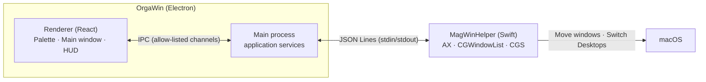

OrgaWin is a window management app that lives in the macOS menu bar. It does two things.

| Feature             | In one line                                                                                                                                                                 | Docs                                             |
| ------------------- | --------------------------------------------------------------------------------------------------------------------------------------------------------------------------- | ------------------------------------------------ |
| **Edge grid snap**  | Rest the cursor on the edge of another app's window and a grid palette appears. Pick a cell (a rectangle) and the window moves there.                                       | [Using edge snap](guide/edge-snap.md)            |
| **Desktop layouts** | Save the current window arrangement, including which Desktop each window was on. On restore, OrgaWin switches to that Desktop first, then launches apps and places windows. | [Saving and restoring layouts](guide/layouts.md) |

## Architecture



- The UI and logic are written in **TypeScript** (Electron + React). Follow the [coding standards](development/coding-standards.md).
- Electron cannot read or move other apps' windows, so a small **Swift helper** does it. The reasons are in [ADR-001](architecture/decisions/adr-001-swift-helper-process.md).

## Quick start

```bash
pnpm install
pnpm dev
```

`pnpm dev` builds the Swift helper and then launches the app. On first launch it asks for **Accessibility** permission. See [Getting started](guide/getting-started.md) for details.

## Constraints to know

- macOS has **no public API** to send another app's window to a specific Desktop. So OrgaWin restores in this order: "switch to the Desktop first → launch the app there → place the window" ([ADR-002](architecture/decisions/adr-002-desktop-first-restore.md)).
- Desktop switching works by pressing the Mission Control shortcuts you have configured ([ADR-003](architecture/decisions/adr-003-keyboard-desktop-switching.md)).
- Development environment: macOS 26.6 (Apple Silicon), Xcode 26 / Swift 6.2, Node 22.
